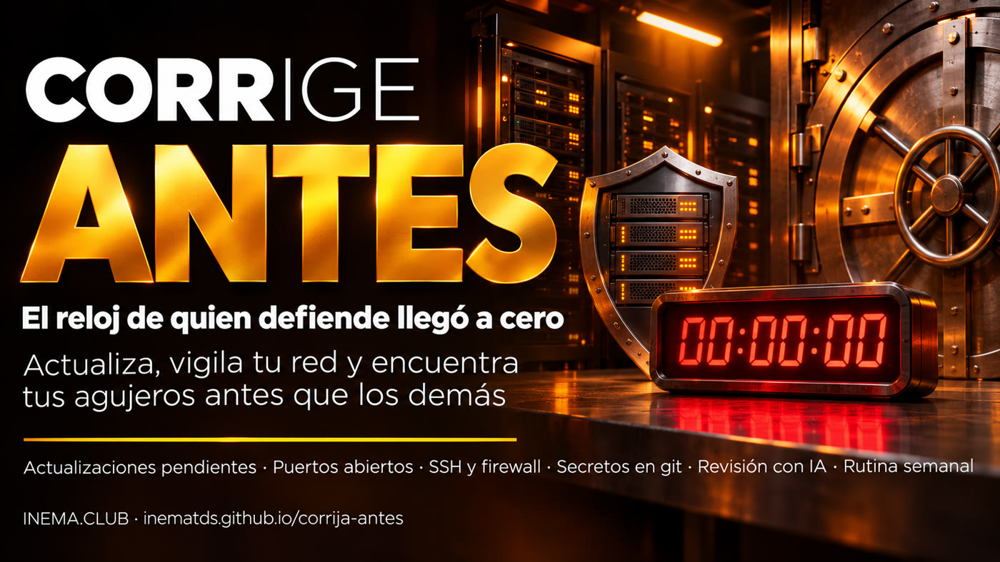

> **Uso defensivo:** ejecútelo solo en SU computadora y en SUS repositorios. El kit solo lee: no instala, no actualiza, no corrige, no revisa otras computadoras ni envía nada: solo consulta los servidores de actualización de su propio sistema.

# corrija-antes — el reloj de quien defiende

[](https://inematds.github.io/corrija-antes/guia/es/)

**🇧🇷 [Português](README.md) · 🇺🇸 [English](README.en.md) · 🇪🇸 [Español](README.es.md)**

## Qué es

En julio de 2026, las IA abiertas estaban de 4 a 7 meses detrás de las cerradas en ataques. En octubre, en una prueba de intrusión en la red de una empresa, esa distancia llegó a cero: quienes defienden perdieron la ventaja de tiempo. corrija-antes es un kit gratuito que hace, en tu computadora, las tres cosas que todavía funcionan: **actualizar más rápido, vigilar la red y encontrar tus brechas antes que los demás**. Un script de diagnóstico muestra qué corregir AHORA y qué puede esperar hasta la semana, y un prompt listo le pide a la IA que revise tu código. Sirve para quienes tienen una computadora, un servidor o una aplicación en línea y no trabajan con seguridad todos los días. Necesitas Python 3 (Linux o macOS).

## 📖 Guía de uso

Guía completa, con el video: **https://inematds.github.io/corrija-antes/guia/es/**

Video: [China liberó gratis la IA hacker que OpenAI bloqueó](https://www.youtube.com/watch?v=1WFT-VgGuPM) · [versión vertical](https://youtube.com/shorts/-R65CemeRvc)

## Prueba en 1 minuto

```bash
git clone https://github.com/inematds/corrija-antes.git
cd corrija-antes
python3 relogio.py --repo ~/seu-projeto --saida relatorio
```

Verás una lista en pantalla y un `relatorio/relatorio.md`. Cada elemento tiene una prioridad:

| Prioridad | Qué significa |
|---|---|
| **AGORA** (AHORA) | corrección de seguridad pendiente, base de datos/Redis/Ollama/pantalla remota abierta a la red, SSH con contraseña, secreto en el código |
| **SEMANA** (esta semana) | actualización común, puerto abierto que debes revisar, firewall desactivado, imagen Docker de hace más de 4 meses, `.env` fuera del `.gitignore`, clave con cara de ejemplo, dependencias estancadas |
| **SEM TESTE** (SIN PRUEBA) | no se pudo verificar (faltan permisos o herramientas): no significa que sea seguro |
| **OK** (BIEN) | verificado y al día |

Consulta un [informe de ejemplo](exemplos/relatorio-exemplo.md) (servidor ficticio de una tienda, con datos inventados).

## Los 3 bloques

1. **Actualiza**: paquetes del sistema con correcciones de seguridad (apt, dnf, Homebrew, macOS), snaps, paquetes globales de npm, imágenes Docker en uso de hace más de 4 meses, reinicio pendiente y **cuántos días** han pasado desde la última actualización.
2. **Vigila la red**: qué está escuchando solo en la computadora, solo en la red interna/VPN o abierto a cualquier red; puertos críticos (bases de datos, Redis, Ollama, VNC/RDP, API de Docker); firewall; SSH con contraseña o como root; puertos que Docker publica **por encima de ufw**.
3. **Tus brechas** (`--repo`): `.env` dentro de git, `.gitignore` sin `.env`, claves y tokens escritos en el código (el valor aparece oculto), dependencias sin cambios desde hace más de 4 meses y el recordatorio de la revisión con IA.

   Formatos reconocidos: AWS, OpenAI/Anthropic, DeepSeek, OpenRouter, Stripe, GitHub, Slack (token y webhook), Google, Telegram, Mercado Pago, Groq, Hugging Face, GitLab, SendGrid, npm, Resend, service_role de Supabase, clave privada, contraseña en una URL de base de datos y contraseñas/claves de `wp-config.php`. Solo lee los archivos actuales, no el historial de git; una contraseña genérica (`password=…`) o claves de otros servicios pasan sin aviso.

## Opciones

```bash
python3 relogio.py                              # solo la computadora
python3 relogio.py --repo ~/app --repo ~/api    # computadora + dos repositorios
python3 relogio.py --blocos vigie               # solo un bloque: atualize, vigie, codigo
python3 relogio.py --saida relatorio            # guarda relatorio.md y relatorio.json
python3 relogio.py --json                       # resultado en JSON en pantalla
python3 relogio.py --mostrar-ips                # no oculta IP, usuario ni nombre de la computadora
```

Código de salida: `0` = nada para AHORA · `1` = hay elementos AHORA · `2` = error de uso. Sin `sudo`, algunos elementos aparecen como SIN PRUEBA (por ejemplo, las reglas del firewall); el script indica qué comando ejecutar para verificarlos.

## El proceso, de principio a fin

1. 🧠 **Tú** clonas el kit y ejecutas `python3 relogio.py --repo <seu projeto> --saida relatorio`.
2. ⚙️ **Script** lista los elementos AGORA / SEMANA / SEM TESTE / OK y guarda el informe (solo lee).
3. 🧠 **Tú** haces una copia de seguridad y revisas el estado del sistema antes de cambiar nada.
4. 🧠 **Tú** resuelves los elementos AGORA, uno a la vez ([ROTINA.md](ROTINA.md) (en portugués)).
5. 🤖 **IA** (Claude Code, Codex o modelo local) revisa tu código con el [prompt de revisión](prompts/revisao-com-ia.md) (en portugués).
6. ⚙️ **Script** vuelve a ejecutarse para confirmar; opcional: todos los lunes mediante cron.

## Para profundizar (kits INEMA de auditoría y diagnóstico)

| Kit | Para qué sirve |
|---|---|
| [auditoria-seguranca](https://inematds.github.io/auditoria-seguranca/guia/) | comprueba si tus herramientas aún confían en certificados filtrados y si PHP tiene la vulnerabilidad PHP2Shell |
| [blinda-site](https://inematds.github.io/blinda-site/guia/) | diagnóstico interno del sitio: plan, copia de seguridad, simulación y niveles de riesgo |
| [invada-seu-proprio-app](https://inematds.github.io/invada-seu-proprio-app/guia/) | las 5 brechas más comunes de una aplicación hecha con IA, probadas en tu copia de prueba |
| [agente-blindado](https://inematds.github.io/agente-blindado/guia/) | 5 bloqueos contra la inyección de prompts y 10 ataques para probar tu agente |
| [caixa-do-agente](https://inematds.github.io/caixa-do-agente/guia/) | evaluación de tu harness de agente y una caja Docker descartable, sin red ni `.env` |
| [ia-sem-censura-defensiva](https://inematds.github.io/ia-sem-censura-defensiva/guia/) | modelo abierto sin restricciones, usado solo para defensa y ejecutado en tu computadora |
| [protegendo-seus-repos](https://inematds.github.io/protegendo-seus-repos/guia/) | copia de seguridad en 3 capas de tus repositorios contra bloqueos o intrusiones |

## Pruebas

```bash
python3 testes/run.py        # 82 pruebas con datos inventados
python3 testes/gera_exemplo.py   # vuelve a generar el informe de ejemplo
```

Python 3, sin dependencias. Contenido original. Licencia [MIT](LICENSE). Más en [INEMA.CLUB](https://inema.club).